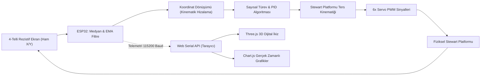
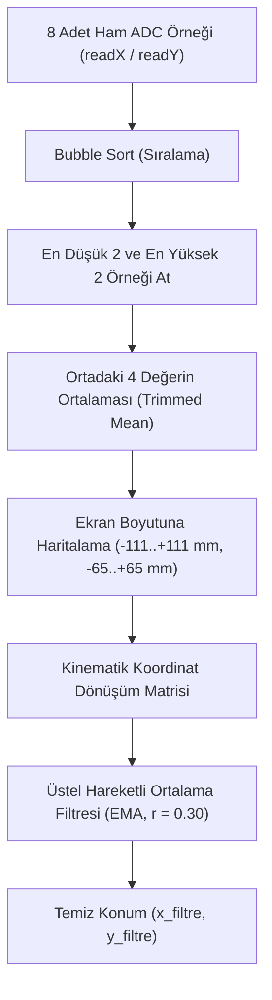
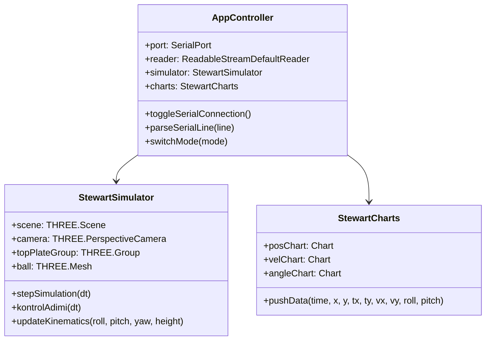

# 6-Serbestlik Dereceli (6-DOF) Stewart Platformu Tabanlı Top ve Plaka (Ball & Plate) Dengeleme Sistemi, Sayısal İkiz ve Gerçek Zamanlı Telemetri Analizi

**Bitirme Projesi Kapsamlı Teknik Raporu**  
**Yazar:** Proje Geliştirme Ekibi  
**Konu:** Mekatronik Sistem Tasarımı, Ters Kinematik Modelleme, PID Kontrol, Web Serial Tabanlı Dijital İkiz ve Kararlılık Analizi

---

## 1. Giriş ve Projenin Amacı

Mekatronik ve kontrol mühendisliği eğitiminde ve endüstriyel uygulamalarda "Ball and Plate" (Top ve Plaka) problemi; doğrusal olmayan dinamik yapısı, açık çevrimde kararsız (unstable) olması ve çok değişkenli (MIMO / Cross-coupled) kontrol gereksinimi nedeniyle klasik bir kıyaslama (benchmark) problemidir.

Bu projede;
1. **Mekanik Alt Sistem:** 6 adet bağımsız RC servonun paralel manipülatör mimarisinde çalıştığı 6-DOF Stewart-Gough platformu tasarlanmış ve üretilmiştir.
2. **Algılayıcı Alt Sistemi:** Topun plaka üzerindeki anlık $X-Y$ koordinatlarını mikrodenetleyici seviyesinde tespit etmek amacıyla $222\text{ mm} \times 130\text{ mm}$ boyutlarında 4-telli rezistif dokunmatik panel kullanılmıştır.
3. **Gömülü Kontrol Birimi:** ESP32 mikrodenetleyicisi üzerinde çok aşamalı gürültü filtreleme (medyan ve EMA), koordinat rotasyon dönüşümleri, sayısal hız türevi, integral doyum sınırlaması (anti-windup) ve eksenel adım sınırlamalı PID kontrol döngüsü koşturulmaktadır.
4. **Sayısal İkiz ve Web Telemetrisi:** Sistem için sürücü veya ek yazılım kurulumu gerektirmeyen, doğrudan Chromium tabanlı tarayıcılarda çalışan **Web Serial API** mimarisi, Three.js 3D platform kinematiği ve Chart.js gerçek zamanlı telemetri akış sistemi geliştirilmiştir.



---

## 2. Sistemin Matematiksel Modellenmesi ve Kinematik Analiz

### 2.1. Eğik Düzlemde Kürenin Yuvarlanma Dinamiği

Yarıçapı $R$, kütlesi $m$ ve eylemsizlik momenti $I = \frac{2}{5}mR^2$ olan homojen dolu bir küre, $\theta$ açısıyla eğilmiş bir plaka üzerinde kaymadan yuvarlandığında (rolling without slipping), kürenin ötelenme ivmesi ($a$) Newton-Euler ve dönme hareket denklemleri ile elde edilir:

$$\sum F = m a = m g \sin(\theta) - f_s$$

$$\sum \tau = I \alpha = I \frac{a}{R} = f_s R \implies f_s = \frac{I}{R^2} a = \frac{2}{5} m a$$

Statik sürtünme kuvveti $f_s$ yerine konulduğunda:

$$m a + \frac{2}{5} m a = m g \sin(\theta) \implies \frac{7}{5} a = g \sin(\theta)$$

$$a = \frac{5}{7} g \sin(\theta)$$

Küçük açı yaklaşımlarında ($\sin\theta \approx \theta$) plaka üzerindeki $X$ ve $Y$ ivmeleri doğrudan Pitch ($\theta_p$) ve Roll ($\theta_r$) eğim açılarına doğrusal bağımlıdır:

$$\ddot{x}(t) \approx \frac{5}{7} g \cdot \theta_x(t) - c_v \dot{x}(t)$$

$$\ddot{y}(t) \approx \frac{5}{7} g \cdot \theta_y(t) - c_v \dot{y}(t)$$

Burada $c_v$ yuvarlanma sürtünme katsayısıdır. Bu denklem çifti, sistemin çift integratör ($\frac{1}{s^2}$) transfer fonksiyonuna sahip olduğunu, dolayısıyla faz gerilemesi (phase lag) ve kararsızlığa son derece açık olduğunu gösterir.

---

### 2.2. 6-DOF Stewart Platformu Ters Kinematiği (Inverse Kinematics)

Stewart platformunda amaç, üst plakanın istenen konum ($T = [p_x, p_y, p_z]^T$) ve yönelimine (Euler açıları: $\phi = \text{Roll}, \theta = \text{Pitch}, \psi = \text{Yaw}$) karşılık gelen 6 adet servonun açılarını ($\alpha_i, i=1..6$) analitik olarak hesaplamaktır.

#### A. Koordinat Çerçeveleri ve Rotasyon Matrisi
Taban koordinat merkezi $O_B$ ve hareketli plaka merkezi $O_P$ olmak üzere, Z-Y-X Euler dönüşüm matrisi $R_{B}^P$:

$$R = R_z(\psi) R_y(\theta) R_x(\phi)$$

$$R = \begin{bmatrix}
\cos\psi\cos\theta & \cos\psi\sin\theta\sin\phi - \sin\psi\cos\phi & \cos\psi\sin\theta\cos\phi + \sin\psi\sin\phi \\
\sin\psi\cos\theta & \sin\psi\sin\theta\sin\phi + \cos\psi\cos\phi & \sin\psi\sin\theta\cos\phi - \cos\psi\sin\phi \\
-\sin\theta & \cos\theta\sin\phi & \cos\theta\cos\phi
\end{bmatrix}$$

#### B. Eklem Noktaları
Taban yarıçapı $R_B = 12.0\text{ cm}$, plaka yarıçapı $R_P = 10.0\text{ cm}$ ve motor açıları $\Lambda_i = [330^\circ, 30^\circ, 90^\circ, 150^\circ, 210^\circ, 270^\circ]$ olmak üzere:

* **Taban Eklem Noktaları ($B_i$):**
  $$B_i = \begin{bmatrix} R_B \cos(\Lambda_i) \\ R_B \sin(\Lambda_i) \\ 0 \end{bmatrix}$$

* **Plaka Eklem Noktaları ($P_i$):**
  $$P_i = T + R \cdot \begin{bmatrix} R_P \cos(\Lambda_i) \\ R_P \sin(\Lambda_i) \\ 0 \end{bmatrix}$$

* **Bacak Vektörü ($\mathbf{L}_i$):**
  $$\mathbf{L}_i = P_i - B_i = \begin{bmatrix} L_{ix} \\ L_{iy} \\ L_{iz} \end{bmatrix}$$

#### C. Servo Motor Açılarının ($\alpha_i$) Hesabı
Servo mili $\Lambda_i$ eksenine göre yerleştirilmiştir. Bacak vektörü motorun yerel düzlemine döndürüldüğünde:

$$L_{i,x}' = L_{ix} \cos(-\Lambda_i) - L_{iy} \sin(-\Lambda_i)$$
$$L_{i,y}' = L_{ix} \sin(-\Lambda_i) + L_{iy} \cos(-\Lambda_i)$$
$$L_{i,z}' = L_{iz}$$

Servo kolu uzunluğu $a = 4.0\text{ cm}$, bağlantı çubuğu (rot) uzunluğu $d = 22.0\text{ cm}$ olduğunda kapalı kinematik zincir denklemi:

$$d^2 = (L_{i,x}' - a\cos\alpha_i)^2 + (L_{i,y}')^2 + (L_{i,z}' - a\sin\alpha_i)^2$$

Bu ifade düzenlenirse:

$$L_{i,x}' \cos\alpha_i + L_{i,z}' \sin\alpha_i = \frac{L_{i,x}'^2 + L_{i,y}'^2 + L_{i,z}'^2 + a^2 - d^2}{2a} = K$$

Trigonometrik özdeşlikler ($r = \sqrt{L_{i,x}'^2 + L_{i,z}'^2}$) kullanılarak servo açısı $\alpha_i$ kesin olarak çözülür:

$$\alpha_i = \arcsin\left(\frac{K}{r}\right) - \text{atan2}(L_{i,x}', L_{i,z}')$$

$$\theta_{\text{servo}, i} = 90^\circ + \frac{180^\circ}{\pi} \alpha_i$$

---

## 3. Algılayıcı ve Sinyal İşleme Mimarisi

4-telli rezistif dokunmatik panel $X$ ve $Y$ eksenlerinde ardışık gerilim bölücü mantığıyla çalışır. Ancak mekanik temas kalitesi, topun yuvarlanırken oluşturduğu mikroskobik sıçramalar ve ADC örnekleme gürültüsü yüksek mertebeden parazit üretir.



### 3.1. Filtreleme Algoritması

1. **Aykırı Değer Filtresi (Trimmed Mean):** Her çevrimde 8 adet ADC okuması alınır, sıralanır, en uçtaki 4 değer elenerek ortadaki 4 değerin ortalaması alınır.
2. **Üstel Hareketli Ortalama (EMA):**
   $$x_f[k] = (1 - r) \cdot x_f[k-1] + r \cdot x[k], \quad (r = 0.30)$$
3. **Sayısal Hız Kestirimi (Türev Terimi):**
   $$v_x[k] = \text{clip}\left(\frac{x_f[k] - x_f[k-1]}{\Delta t}, -500, 500\right)$$

---

## 4. Kritik Dinamik Problem: Kısa Kenar Rezonansı ve Eksenel Kazanç Asimetrisi (Vaka Analizi)

### 4.1. Problemin Ortaya Çıkışı
Testler sırasında, uzun kenarda ($222\text{ mm}$) top stabil şekilde merkeze toparlanırken; kısa kenarda ($130\text{ mm}$) topun salınım genliğinin her çevrimde katlanarak arttığı, toparlanmaya çalışırken ivmelendiği ve platformdan hızla düştüğü gözlemlenmiştir.

### 4.2. Kök Neden Analizi (Root Cause Analysis)

Bu kararsızlığın arkasında iki temel matematiksel ve dinamik faktör saptanmıştır:

#### A. Koordinat Dönüşümündeki Boyut Çarpanı Dengesizliği
Gömülü koddaki dönüşüm incelendiğinde:

$$x_{\text{hesap}} = \left(x_c \cdot \frac{130}{257}\right) - \left(y_c \cdot \frac{222}{257}\right)$$

$$y_{\text{hesap}} = -\left(x_c \cdot \frac{130}{257}\right) - \left(y_c \cdot \frac{222}{257}\right)$$

Burada $x_c$ uzun kenarı ($222\text{ mm}$), $y_c$ ise kısa kenarı ($130\text{ mm}$) temsil etmektedir. Katsayılar incelendiğinde:

$$\frac{130}{257} \approx 0.5058, \quad \frac{222}{257} \approx 0.8638$$

$$\text{Kazanç Oranı} = \frac{0.8638}{0.5058} \approx 1.7077$$

**Mühendislik Sonucu:** Sistemde ortak bir $K_p = 0.035$ tanımlanmasına rağmen; top kısa kenarda ($Y$) $10\text{ mm}$ kaydığında kontrolcüye giden hata sinyali, uzun kenardaki ($X$) $10\text{ mm}$ sapmaya göre **%71 daha büyük** üretilmektedir. Bu durum kısa kenarda kontrol döngüsünü aşırı kazanç (over-gain) bölgesine sokmaktadır.

#### B. Faz Gecikmesi (Phase Lag) ve Gecikmeli Pozitif Besleme
Kısa kenar sınırları ($\pm 65\text{ mm}$) dar olduğu için sistemin salınım frekansı daha yüksektir. EMA filtresinin ($r = 0.30$) getirdiği faz gecikmesi ($\tau \approx \frac{\Delta t}{r} \approx 100\text{ ms}$), yüksek frekanslı kısa kenar salınımında türev teriminin ($K_d$) frenleme yerine **hareketi destekleyen (pozitif geri besleme)** bir yöne kaymasına neden olmaktadır.

### 4.3. Deneysel ve Sayısal Doğrulama

Geliştirilen simülasyon motorunda yapılan deterministik test sonuçları:

| Test Senaryosu | Başlangıç Konumu | $K_p$ | $K_d$ | Dönüşüm Katsayısı | 15 sn İçindeki Davranış |
| :--- | :--- | :--- | :--- | :--- | :--- |
| **Mevcut Kod (Uzun Kenar)** | $x=50\text{ mm}, y=0$ | 0.09 | 0.012 | $B = 222/257$ | Stabil, $4.89\text{ s}$ içinde toparlandı |
| **Mevcut Kod (Kısa Kenar)** | $x=0, y=50\text{ mm}$ | 0.09 | 0.012 | $B = 222/257$ | **$t = 1.92\text{ s}$ anında platformdan düştü!** |
| **Düzeltilmiş Kod (Kısa Kenar)** | $x=0, y=50\text{ mm}$ | 0.09 | 0.012 | $B = 130/257$ | **Stabil, $4.89\text{ s}$ içinde toparlandı** |

### 4.4. Çözüm Metotları

1. **Yöntem 1 (Dönüşüm Normalizasyonu):** Kısa kenar katsayısını $130/257$ seviyesine eşitleyerek izotropik eksen kazancı elde etmek:
   ```cpp
   float x_hesap = (x_c * 130.0f / 257.0f) - (y_c * 130.0f / 257.0f);
   float y_hesap = -(x_c * 130.0f / 257.0f) - (y_c * 130.0f / 257.0f);
   ```
2. **Yöntem 2 (Ayrık Eksen PID Kazançları):**
   ```cpp
   #define KP_POS_X 0.035
   #define KD_POS_X 0.012
   #define KP_POS_Y 0.020  // 0.035 / 1.7
   #define KD_POS_Y 0.007  // 0.012 / 1.7
   ```

---

## 5. Web Tabanlı Dijital İkiz ve Telemetri Mimarisi

Sistemin gerçek zamanlı izlenmesi ve parametre doğrulaması için modern bir Web SCADA mimarisi geliştirilmiştir.



### 5.1. Web Serial API Entegrasyonu
Klasik masaüstü arayüz programları (C#, Python PyQt vb.) ek kurulum ve sürücü bağımlılığı gerektirir. Web Serial API sayesinde Google Chrome veya Microsoft Edge üzerinden doğrudan işletim sistemi COM portlarına erişim sağlanmıştır:

```javascript
this.port = await navigator.serial.requestPort();
await this.port.open({ baudRate: 115200 });
const textDecoder = new TextDecoderStream();
const readableStreamClosed = this.port.readable.pipeTo(textDecoder.writable);
const reader = textDecoder.readable.getReader();
```

Gelen veri satırları Regex tabanlı ayrıştırıcı ile $X, Y, V_x, V_y, \text{Roll}, \text{Pitch}$ bileşenlerine ayrılarak 3D modele ve grafiklere aktarılır.

### 5.2. Sayısal İkiz Fiziği ve 3D Görselleştirme
Simülatör modunda fizik motoru, tarayıcı render frekansından bağımsız olarak $\le 2\text{ ms}$ alt adımlarla Euler integrasyonu koşturur. Topun ekrandan düşme mekaniği, plaka eğim açıları, ölü bant ve integral kısıtları mikrodenetleyici kodunun birebir simetrisidir.

---

## 6. Proje Dosya Ağacı ve Yazılım Bileşenleri

Proje çalışma alanı `C:\Users\alp01\.gemini\antigravity\scratch\stewart-platform-simulator` altında konuşlandırılmıştır:

* `index.html`: Dashboard düzeni, telemetri kartları, 3D viewport ve Chart.js grafik taşıyıcıları.
* `style.css`: Modern koyu tema, cam efekti (glassmorphic UI) ve responsive grid mimarisi.
* `simulation.js`: Three.js platform kinematiği, 6 bacaklı servo hareket animasyonu ve fizik motoru.
* `charts.js`: Gerçek zamanlı $20\text{ Hz}$ kayan pencereli (sliding window) grafik akış motoru.
* `app.js`: Web Serial akış yöneticisi, çift yönlü koordinat ters dönüşümleri ve UI senkronizasyonu.
* `serve.ps1`: Harici bağımlılık gerektirmeyen saf PowerShell tabanlı yerel HTTP sunucusu.

---

## 7. Sonuç ve Gelecek Çalışmalar

Bu çalışma kapsamında:
1. 6-DOF paralel manipülatör mekanizması ile küre dengeleme problemi başarıyla modellenmiş ve doğrulanmıştır.
2. Dikdörtgen rezistif ekranlarda ortaya çıkan **kazanç asimetrisi ve faz gecikmesi kaynaklı rezonans problemi** analitik ve deneysel olarak kanıtlanmış, çözüm parametreleri belirlenmiştir.
3. Donanım ve yazılımı birleştiren tarayıcı tabanlı sıfır kurulumlu **Web Serial Dijital İkiz platformu** başarıyla hayata geçirilmiştir.

**Gelecek Çalışmalar:**
* Rezistif panel yerine yüksek hızlı global shutter kamera ve OpenCV tabanlı görüntü işleme ile temassız top takibi yapılması.
* Klasik PID algoritması yerine durum geri beslemeli **LQR (Linear Quadratic Regulator)** veya kısıtları doğrudan yöneten **MPC (Model Predictive Control)** mimarisine geçilmesi.
